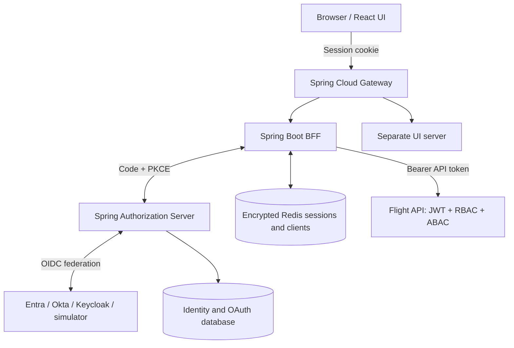

# Architecture and design

## Introduction

The browser should not own OAuth access or refresh tokens. A BFF owns those tokens and gives React a protected session cookie. A separately deployed authorization server supports local accounts and external corporate identity providers. APIs enforce their own business permissions, so a gateway route never constitutes permission to access a resource.

## Architecture overview



Gateway and identity-server public addresses are different in the runnable local topology. Both addresses must remain reachable by the browser. APIs, BFF and Redis should be private in a deployed environment. The gateway only forwards approved BFF paths and static UI requests; it never exposes a general-purpose proxy to arbitrary services.

## Authentication activity

```mermaid
sequenceDiagram
    participant Browser
    participant BFF
    participant Identity as Authorization server
    participant IdP as External provider
    Browser->>BFF: GET /oauth2/authorization/platform via gateway
    BFF-->>Browser: Redirect to Identity /oauth2/authorize
    Browser->>Identity: Follow authorization request
    alt Local account
        Browser->>Identity: Submit login form with CSRF token
        Identity->>Identity: Verify password hash and enabled state in DB
    else External account
        Identity-->>Browser: Redirect to configured provider
        Browser->>IdP: Authenticate with corporate policy
        IdP-->>Browser: Code for Identity callback
        Browser->>Identity: /login/oauth2/code/{provider}
        Identity->>IdP: Redeem upstream code server-side
        Identity->>Identity: Resolve approved issuer + subject link
    end
    Identity-->>Browser: Code for BFF callback
    Browser->>BFF: /login/oauth2/code/platform via gateway
    BFF->>Identity: Redeem code with client credential and PKCE
    Identity-->>BFF: Application-issued tokens
    BFF->>BFF: Save encrypted client and session in Redis
    BFF-->>Browser: Opaque session cookie; redirect to UI
```

There are two OAuth client registrations in external SSO: the authorization server is a client of the external provider; the BFF is a client of the application authorization server. The UI is neither. Provider callbacks go to the identity server, not to React.

## Authorization flow

1. React sends a session cookie through the gateway to a fixed BFF business endpoint.
2. BFF loads the authorized client for this **session**, not globally for the subject.
3. BFF coordinates token refresh using a Redis owner-checked lock. Default refresh clock skew is Spring's standard value; near-expiry tokens may refresh before actual expiry.
4. BFF forwards only its server-owned access token and bounded correlation ID.
5. Flight API validates RSA signature, issuer, expiry, and audience `flight-api`.
6. The owning API requires a read/write scope **and** an application role. Requesting `flights.write` does not grant a viewer write access.
7. ABAC compares the resource's server-owned terminal to the signed terminal assignments. User-provided terminal values cannot override resource ownership.
8. Failures return 401 for invalid authentication, 403 for insufficient permission, 404 for missing resources, or 503 for relevant unavailable dependencies.

## Persistence boundaries

| Store | Data | Lifetime |
|---|---|---|
| Identity DB | Password hashes, enabled status, roles, terminal assignments, issuer/subject links | Persistent |
| OAuth tables in identity DB | Registered clients, grants, refresh tokens, consent | Persistent; add retention cleanup in production |
| Redis BFF session | Security context including OIDC identity | Session timeout; AES-GCM encrypted |
| Redis authorized client | Access/refresh token records, separated by browser session | 30-minute maximum TTL; AES-GCM encrypted |
| Flight resources | Two deterministic fixtures | Not a business persistence implementation |

H2 file storage keeps native execution simple and works in single-replica demos across all modes. PostgreSQL JDBC support is packaged; set AUTH_DB_URL/USER/PASSWORD to use it. PostgreSQL deployment/migration compatibility is an unexecuted path until separately validated. The sample uses startup schema creation, not a production migration pipeline.

## Design decisions

- Separate identity server and BFF: clearer trust boundaries and independently replaceable identity implementation.
- Stable application issuer: APIs do not need to understand every corporate provider.
- Explicit identity links: prevent unsafe email-based account takeover.
- Per-session tokens: two browsers for the same user do not share a rotating refresh token.
- No automatic write replay: a timeout can happen after a downstream write commits.
- Local policy example: role rules are code-owned in FlightPolicy; identity grants come from the DB and are snapshotted into tokens. **No background central-policy sync service is implemented or claimed.**

## Refresh, revocation, and outages

A failed/expired refresh requires sign-in again. Redis unavailability must prevent session access or token acquisition. The identity service is required for new login and refresh but not for every JWT validation. Cached JWKS permit validation of known signing keys; missing keys fail authentication.

The refresh lock has a 30-second lease. Token HTTP calls must be bounded below the lease; unbounded stalls or network partitions can still invalidate simple lease assumptions. This reference is not a formally fenced distributed transaction implementation.

Logging out of the BFF deletes its token record and session, but does not end the authorization server or upstream SSO session. Already issued JWTs can remain valid until expiry. Define a deprovisioning SLA and implement central revocation/session propagation before production.
